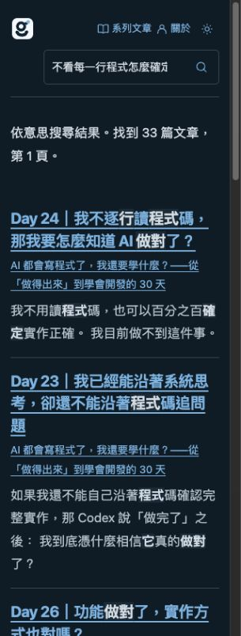

# Cloudflare 自動同步索引：２０２６－１０－２１

使用者授權將文章索引更新部署到 Cloudflare、自動同步真正公開的新文章、停用本機每小時任務，維持免費方案硬上限，完成驗證後啟用；搜尋頁設計及發文／訂閱者流程不變。

## 已確認的實作與部署

同一搜尋 Worker `gcake-public-search-production` 增加每分鐘排程及受保護的操作入口，沿用正式 D1、BGE-M3 與 Vectorize，沒有新增付費服務。D1 保存單一租約、批次進度、相容向量清冊、待核對輸出與３０天收據。推論前與讀者共享原子額度預留；完整讀回向量與來源修訂後才條件式切換版本。只刪除清冊能證明屬於本搜尋、且已不在目前公開來源的 ID。結果不明的推論保留扣額並停止，已保存的上傳可安全續作。

本機 Codex 任務 `automation-2` 已暫停；正式維護不需要本機開機，也不保存人員 OAuth。原正式搜尋持續啟用；背景同步先以無排程且停用狀態部署，再明確啟用 `INDEX_SYNC_ENABLED=true` 與每分鐘 cron。正式程式完整讀回與本機 bundle 相同：３８６９９ bytes，SHA-256 `088e28c38e15467fe3e8fae128568ff693cff8346a894240a0d37cf1b1a30918`；啟用版本 `d254daa6-fc06-4d94-8d1c-5d7dc481f0cc`。

## 已完成的驗證

- 以原有完整本機 gate 驗證：`pnpm test`、`pnpm check`、`pnpm build:all`、`pnpm release:dry-run`、`pnpm editorial:rehearse`。最初 sandbox 禁止本機 listener，保留失敗紀錄後，在允許 listener 的相同環境執行原斷言通過。Node ２４．１９．０、Python ３．１２；沒有跳過 Hermes 或修改既有斷言。
- 完整 aggregate 當時包含４２個 search-worker 測試；後續補上收據保留及相容向量重用情境，該套４４個測試全部通過。正式 runtime source 未再變動。新增的收據時間索引避免每分鐘掃描３０天歷史而消耗免費 D1 讀取額度。
- 第一版無行為的同步入口先產生實際 assertion 失敗，再完成實作通過。涵蓋正常預留／讀回／提升、停用與到期、重疊執行、額度不足、推論結果不明不重播、遺失上傳回覆續作、來源或操作者更動、數值被改不提升、只清理已核實舊資料，以及相容快取零推論。
- 完整重新讀回現有正式２６３３個向量，namespace、metadata、１０２４個值均對照既有相容輸出，誤差低於１０⁻⁶；核對公開來源未變後才建立清冊。沒有為既有文章重算 embedding。
- 同一同步核心在暫時 Cloudflare Worker，以實際公開的２段、再１６段文章處理，使用真實 BGE-M3／Vectorize／共享 D1 預留。兩輪均經 uploaded → awaiting_readback → verified → promoted → no_change；最大批次另實際清理前輪２個測試向量。合計１８段預留，２次模型批次呼叫，沒有對等待中的結果重做推論。
- 隔離驗收使用真正公開文章的文字與修訂，但採獨立測試 corpus／IDs，沒有發布假文章或提升正式作用中 corpus。此證據證明真實雲端接線與續作，不冒稱自然新文章已出現。
- 先部署無 cron、`INDEX_SYNC_ENABLED=false`，實際操作入口回 disabled，正式 `/v1/search` 仍回 hybrid；再依使用者授權啟用排程。初次正式部署曾遭自動審核拒絕，原因是雲端讀回未完成且候選含 cron；完成讀回並改採無 cron 停用驗證後才重新部署。
- 原 GitHub Pages 搜尋 HTML 與先前正式部署產物逐 byte 一致，沒有重部署 Pages。Computer Use 實際送出自然語句，顯示３３篇語意結果，首篇為 Day 24；只有１個搜尋框、０個下拉選單。３２０像素畫面 scrollWidth 為３０５，沒有水平溢出，驗證後恢復原視窗。
- 暫時驗收 Worker 已刪除，１８個先後使用的測試 IDs 均已清理（前輪２個由同步流程清理，後輪１６個另完整確認刪除），隔離測試資料表已移除，正式索引回到２６３３個。共享 reservation 保留，未退額度。原 dirty checkout、其他進行中工作及 HEAD 均維持原狀。

## 免費限制與執行範圍

模型仍為 `@cf/baai/bge-m3`、plain／１０２４維／cosine；不升級、不加購、不換模型、不生成回答。每日８０００ Neurons 等本站保守上限與供應商 Workers Free 硬上限維持，讀者與維護共用預留。每日 UTC 重設只建立當日列一次，不補滿已消耗額度。既有證據期限仍為 `2026-11-20T00:00:00Z`，沒有自動延長。

每分鐘是檢查／續作頻率；每批最多１６段，而且必須等待供應商讀回。整份更新時間依文章量、快取、索引延遲及共享剩餘額度而變，不承諾一分鐘完成。更新期間保留目前公開版本的關鍵字搜尋。未確認完成、來源再變、服務停用、過期或容量不足均不能提升舊資料。

驗收紀錄建立當時直接部署已通過驗證的隔離候選，尚未 commit、push、建立 PR 或執行新 main CI；不能把先前 main CI 當成新候選 CI。程式來源及本機 gate 詳細身分保存在本次 output 收據。歷史任務１．１缺少早期實作前紅測試的事實保留；任務１２．２仍等待第一個自然變更公開文章庫的獨立正式驗收，不以這次測試 namespace 代替。

## 證據

原始操作紀錄位於 `output/discovery/cloud-hosted-sync-20261021/`；原本正式部署證據與收據保持不變。本次可入版的收據見 [cloud-hosted-sync-20261021.json](cloud-hosted-sync-20261021.json)，不包含憑證、向量 payload 或原始讀者查詢／IP。

排程變更由 Cloudflare 傳播，官方說明可能需要數分鐘、最長１５分鐘，不能把設定回覆當成已執行。操作手冊依 [Cron Triggers 官方文件](https://developers.cloudflare.com/workers/configuration/cron-triggers/)、[Vectorize binding](https://developers.cloudflare.com/vectorize/reference/client-api/)及既有 ADR 的免費計價／帳戶證據執行。

## 自然排程驗收

啟用後不再從本機呼叫索引操作入口，D1 自行新增兩筆 no_change 收據：UTC １５：４９：３２及１５：５０：３０（臺灣時間２３：４９：３２及２３：５０：３０）。兩筆均晚於最後人工呼叫收據＃１，對應背景預留的 requests／tokens／Neurons／新增儲存皆為零，只扣維護的 Worker／D1 保守配置；正式作用中政策、來源與２６３３個向量不變。這是 Cloudflare 自行執行的證據，與人工 trigger、隔離 namespace 驗收及未來新文章的首次自然提升分開記錄。

本次第１３組３項全部完成。仍未勾選的１．１是歷史紅測試缺口；１２．２等待第一個自然變更公開版本的正式同步收據，不是尚未部署。免費／隱私證據屆期核實仍依 ADR-001 辦理。

相關文件：[操作手冊](../../../docs/article-discovery-runbook.md)、[ADR-001](../../../docs/decisions/ADR-001-cloudflare-semantic-search.md)、[設計契約](design.md)、[任務狀態](tasks.md)。

本次後續提交整理僅納入上述實作、規劃、操作文件、歷史轉換紀錄與驗收證據；不更動正式服務。JSON 中 candidate.committed=false 是部署驗收當時的快照。產生型別檔只移除本輪重複追加的型別匯出，保留既有基線；不影響正式執行 bundle。
