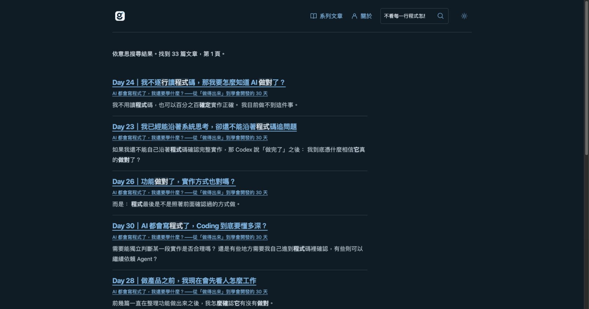
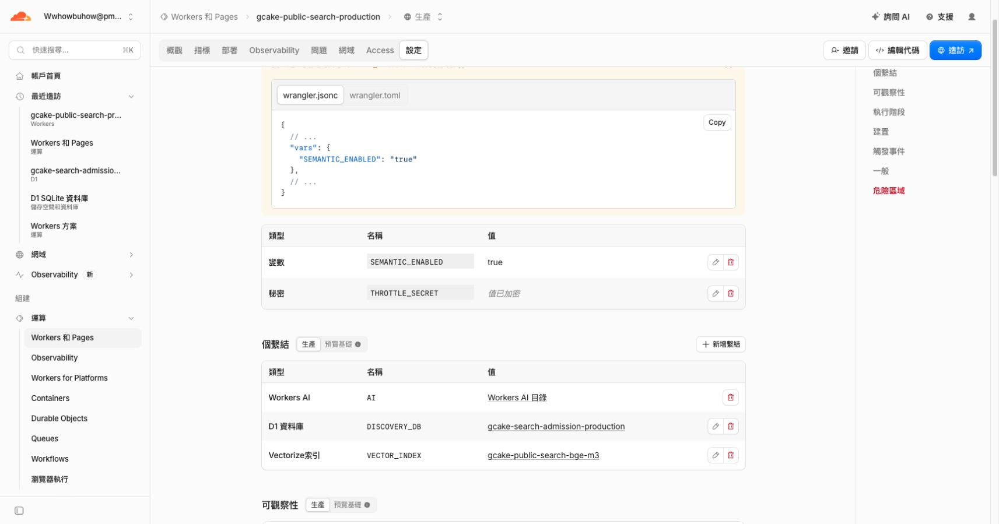

# Cloudflare 正式語意搜尋驗收

２０２６－１０－２１。驗收結束時，正式 BGE-M3 語意搜尋已啟用，保持原先確認的精簡搜尋設計。完整結構化結果見 [JSON](cloud-production-acceptance-20261021.json)，持續決策見 [ADR-001](../../../docs/decisions/ADR-001-cloudflare-semantic-search.md)。本紀錄回填本次已取得的驗收證據；前次停用、準備與失敗紀錄保留，不回寫成成功。文件整理與提交不改變正式設定。

## 交付版本

- PR ＃５１、＃５２、＃５３均已合併。本次驗收對應的 main 是 `ea343588c235d802a1785279193033a21517a780`；main CI [39614815578](https://github.com/gcake119/gcake-dev/actions/runs/39614815578) 成功。PR ＃５３的 CI [39614279454](https://github.com/gcake119/gcake-dev/actions/runs/39614279454) 亦成功。
- Pages 沿用已成功部署的 `b21ef9d3610cab9e9676071f1b30d93785cfce44`，部署 [39611058211](https://github.com/gcake119/gcake-dev/actions/runs/39611058211) 成功。公開 manifest、搜尋 HTML、文章資產與 artifact 逐位元組及 digest 相同，正式端點已寫入，沒有本機 preview flag。最後的 Worker 修復沒有改文章／頁面，故不重做 Pages 部署。
- 正式 corpus 是 `ebb16a407bbbf0c3f8ec2895b79d200f9603fc7c6254a6bddbdd5991ff3deefb`，３３篇、２６３３段。新舊文章內容、修訂、段落、configurationDigest 完全相同，因此沿用已驗證的 BGE 向量，只以相同全域 ID 更新 namespace，零次額外推論。全部向量逐筆讀回核對 namespace、文章版本、中繼資料及１０２４個數值；索引總數仍是２６３３，沒有舊 namespace 副本殘留。
- 最後 Worker 版本 `94addcab-7bcb-4c19-ae59-430a252c2682`，正式流量１００％，`SEMANTIC_ENABLED=true`；AI、獨立搜尋 D1、Vectorize 及加密 THROTTLE_SECRET 皆存在。正式程式讀回含兩處 manual 下載，沒有舊 error 選項；正式 index.js 的２４８３９位元組與 exact-main 本機 bundle 完全相同，SHA-256 為 `ac2bd408feec51cce12bbe7d36527712ce4e622763ed95cc2c6757830246e226`。Workers Logs／Traces 停用，無生成端點或生成模型呼叫。

## 真實行為與驗證層次

「不看每一行程式怎麼確定它做對」實際 API 回傳２００／hybrid，第一筆是 Day 24，瀏覽器顯示３３篇結果；這是當次觀察，不是固定結果門檻。單筆 curl 端到端觀察為１．４８４３０８秒，樣本數１，不是百分位或效能比較。AI 送出查詢顯示２４篇，第二頁、返回、查詢保留及原文章段落連結均經 Computer Use 操作。只輸入不送出時，觀察到零次搜尋端點請求。

正式關閉開關後，頁面顯示關鍵字結果，curl 回傳５０３／keyword；關閉前後 D1 的剩餘預留額度完全相同。再次開啟後，重試恢復 hybrid 且隱藏重試按鈕。３２０像素明亮與３９０像素暗色的 scrollWidth 分別是３０５／３７５，無橫向溢出，只有一個搜尋欄、零個篩選選單。測完恢復預設視窗大小。非允許來源回傳４０３，錯誤 corpus 回傳４０９。

模型準備使用當期真實公開來源與５４筆既有、修訂有效的凍結部分判定。目標文章前五名命中觀察是 lexical ５３／５４、dense ５１／５４、hybrid ５４／５４；不代表完整相關性標註、全新保留集或人類品質驗收。題目隨文章增加，不設最低題數、不補造同義詞。

本機 Node ２４／Python ３．１２的完整 test、check、網站／workspace build、release dry-run、editorial rehearsal 全通過；PR CI、main CI、供應商、正式資產及瀏覽器分層記錄，不互相替代。

## 免費界線與已知限制

帳戶仍為 Workers Free，未升級、未加購，付費超額授權為零。以供應商免費硬上限及本站每日８０００ Neurons／５００次保守上限運作，UTC ００：００自動建立一次當日額度，切換或部署不補回已用額度。建立索引、測試、未知結果與查詢皆計入；D1 數字是本站預留，不是官方帳單。供應商 GraphQL 當期觀察只有 BGE-M3：１７６次請求、１２１６４３個輸入 tokens、零輸出 tokens；不把這些值換稱實際帳單或即時餘額。

證據有效至２０２６－１１－２０ UTC ００：００。每日不需人工重開；屆期仍須核實帳戶／費率／隱私，否則自動停用。未來新文章公開後，需依操作文件準備／核對／提升相容索引；未準備好時維持新版關鍵字搜尋，不自動升級付費或恢復舊文章。EmbeddingGemma 是未來獨立相容遷移，不能混用向量。

UTC 跨日建立額度、併發只建立一次與不補回已消耗額度，由本機合約測試驗證；正式環境已驗證同日停用／恢復不補額度。本次沒有等待實際跨日，不把本機時鐘情境寫成供應商跨日觀察。

## 診斷、回復與操作注意

首次實際啟用曾因 Workers 不接受 fetch 的 `redirect: error` 而在來源下載前失敗，當時沒有扣模型額度。先加入會失敗的驗收測試，再改為 manual 並拒絕所有重新導向。無 AI／D1／Vectorize 的暫時遠端診斷重現原錯誤，修正後成功讀回三份正式資產；結束後 loopback 關閉、公開診斷腳本４０４、即時觀察停止。

本次另觀察到：CLI 部署後仍開著舊控制台，變更變數時會把舊程式一起帶回。已讀回正式程式確認，重新部署修正版、重新載入控制台再設定後解決。後續 CLI 部署後，先刷新控制台再改設定，並核對當前部署版本及正式程式，不能只看開關文字。此為真實操作失敗及處置，沒有以重跑 CI 取代定位，也沒有放寬來源或付費限制。

## 剩餘項目

本輪３．３與４．３的雲端準備、正式生效與回復驗收已完成。任務１．１仍因早期沒有完整保存每個情境的實作前失敗紀錄而保留未勾選，屬歷史限制，不能事後補造。未來來源增長、索引版本提升、期限前重新核實與模型遷移是持續操作，並非宣稱已有無人排程或已完成未來的供應商驗收。

另附[手機暗色版](evidence/cloud-20261021/semantic-mobile-390-dark.jpg)及[停用後的關鍵字備援](evidence/cloud-20261021/rollback-keyword.jpg)。
