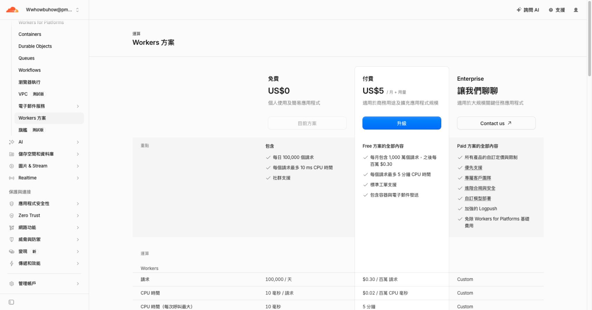
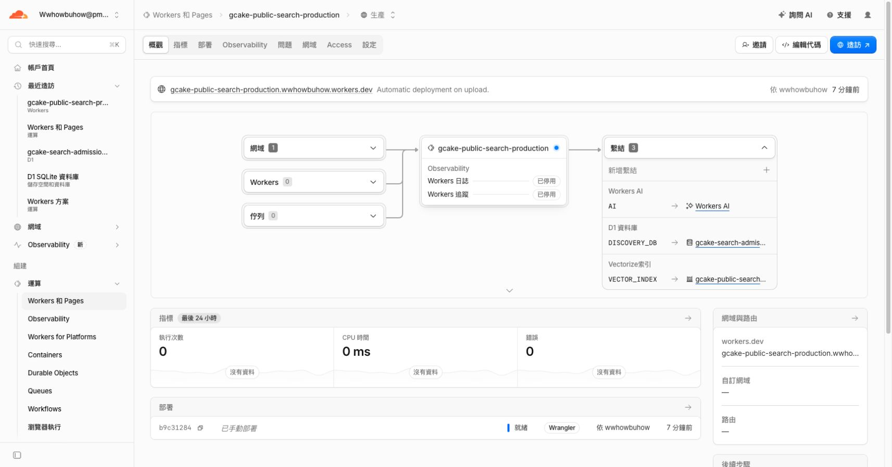

# Cloudflare 接線與 provider 前置驗證

本紀錄保存２０２６－１０－２１已完成的準備，不能當成正式語意搜尋已啟用的證明。持續決策見 [ADR-001](../../../docs/decisions/ADR-001-cloudflare-semantic-search.md)，機器可讀收據見 [JSON](cloud-provider-preflight-20261021.json)。

PR ＃５１已合併為 `9c3fb56`，該版 main CI 與 Pages 部署均通過；公開 manifest、搜尋 HTML 與三份文章資產逐位元組符合部署產物。控制台確認目前是 Workers Free，未升級、未加購；官方計價與全帳戶 AI 用量另有保存，不把應用層的預留數字當成供應商即時餘額。

官方 BGE-M3 真實回應成功，輸出１０２４維。正式３３篇、２６３３段與５４筆來源／修訂仍有效的回歸查詢已完成向量準備；重複文字共用後為２６８５個輸入。上傳後等待非同步處理，再逐筆讀回全部２６３３筆 namespace、文章／修訂 metadata、１０２４維及 float32 值，全部符合。單份索引２６９６１９２維，沒有另建完整保留副本。

依已凍結的有限預期目標，關鍵字前五筆包含５３／５４個目標，雲端 BGE 向量加既有 RRF 後包含５４／５４個目標。這是已看過的回歸資料、部分預期目標及離線排名計算；不是新 held-out、完整相關性標註或人工作品接受，也不是最低分數門檻。真實 Vectorize／Worker 及正式頁面仍須另驗。

最後候選通過既有完整本機 gate：test、check、build:all、release:dry-run、editorial:rehearse；使用 Node 24.19.0、Python 3.12.14，Astro ２６６份檔案零錯誤、零警告。接線、免費額度拒絕、未知結果不重試、每日原子建立且不補滿已消耗額度等先紅後綠紀錄保留於原始輸出。既有 Hermes 在 Python 3.14／高主機負載下的失敗與所有中途錯誤都保留，不改稱通過。

目前搜尋 Worker 已部署實際專案程式，三個綁定與加密節流密鑰已建立，應用日誌與追蹤停用；SEMANTIC_ENABLED 仍為 false。待本次程式的 PR／main CI、正式相容版本與 Computer Use 驗收完成後，另外保存啟用、關閉回復及手機證據。規劃的歷史１．１與尚未完成的３．３／４．３不因這份準備紀錄而自動勾選。
